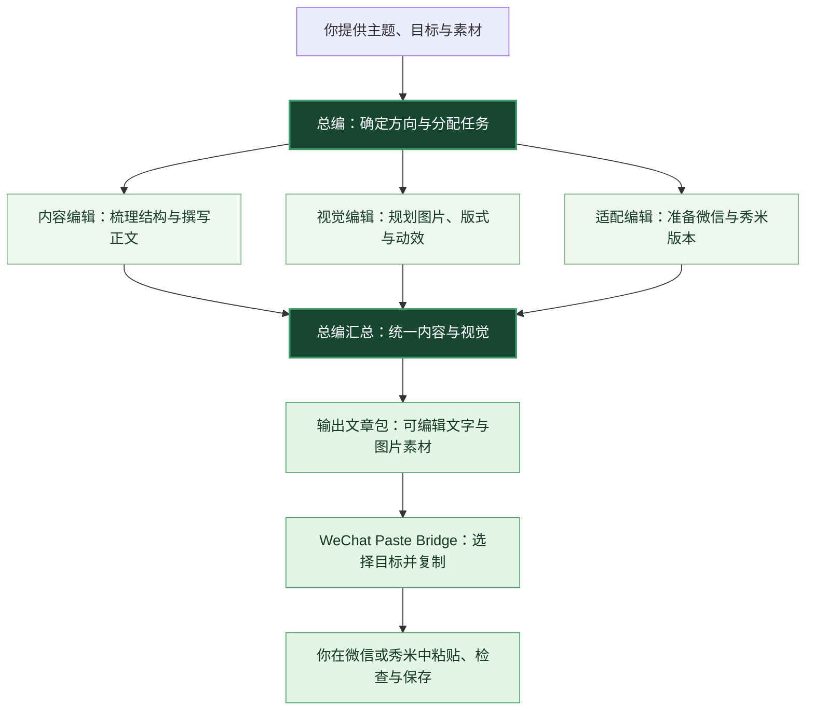
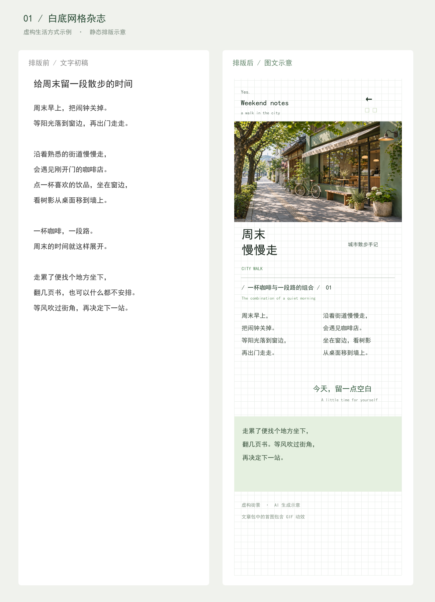
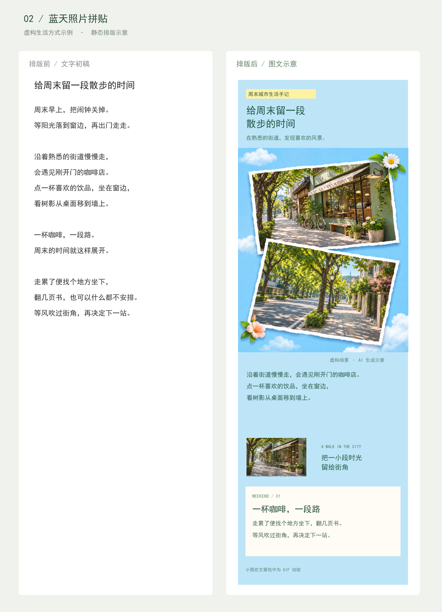

<div align="center">

# Chatgpt生成微信公众号生成技能&一键黏贴发布工具

### 从一个想法，走到一篇可以复制的公众号图文

把主题和素材交给总编，让写作、视觉与编辑器适配围绕同一篇文章协作。

**策划成文 · 图文排版 · 双编辑器文章包**

[查看总编 Skill](skills/wechat-editorial-director/SKILL.md)　｜　[查看团队分工](skills/wechat-editorial-director/references/team.md)　｜　[查看排版示意](#排版前后示意)

</div>

图中的“一键发布草稿”指通过软件复制文章后，由使用者在编辑器中粘贴并手动保存草稿。

## 把想法交给总编

总编先理解文章的读者和目标，再组织内容编辑、视觉编辑与适配编辑完成各自的工作。总编统一文字和视觉，整理成可以导入 **WeChat Paste Bridge** 的文章包。

环境支持且允许调用多个智能体时，可以将职责分派给不同智能体；否则由当前智能体依次完成这些工作。图片、动效和排版在目标编辑器中的效果，由使用者确认。

## 它是怎样运行的？



## 开始使用总编 Skill

将 [`skills/wechat-editorial-director`](skills/wechat-editorial-director) 整个文件夹复制到本机的 `~/.codex/skills/`，重新打开 Codex 后，输入：

```text
使用 $wechat-editorial-director，为我制作一篇公众号文章，并导出文章包。
```

提供主题、目标读者和可用素材后，总编会据此组织制作。涉及真实人物或活动时，请提供有权使用的素材和可核实的信息。

## 配合复制软件使用

**WeChat Paste Bridge** 是 Windows 本地工具，用来选择文章包，并复制到微信公众号编辑器或秀米。它不接收公众号 AppID 或 AppSecret，也不通过公众号 API 自动发布文章。

> 不同文章、浏览器和编辑器的图片、底图、动图、分栏与字体支持情况可能不同。请在目标编辑器检查并预览后再保存或发布。


导入虚构的示例文章包后，可以选择目标编辑器：


截图展示的是软件界面和示例导入状态，不代表微信或秀米的最终粘贴效果。

## 排版前后示意

同一篇虚构的周末城市生活文字，可以根据主题采用不同的视觉节奏。下面分别展示网格杂志和蓝天拼贴两种方向。配图为 AI 生成的虚构场景。

这两张图是静态版式示意，不是微信或秀米的实际截图。GIF、底图与布局以目标编辑器中的实际显示为准。





## 使用流程

1. **生成文章**：让 Codex 根据素材撰写并排版，明确要求正文文字保持可编辑。使用你有权公开的图片。
2. **导出文章包**：让 Codex 按下面的结构生成文件夹；拿到 ZIP 时先解压。仓库中的 `examples/demo-package` 是虚构示例，可用来了解结构。
3. **复制正文**：安装后打开软件，点击“选择文章包”，选中文件夹。检查导入提示，然后按目标选择“复制并打开微信编辑器”或“复制并打开秀米”。
4. **粘贴和检查**：在目标编辑器的正文区域按 `Ctrl+V`。检查图片、底图、横向布局、GIF 和文字编辑效果。秀米请检查“粘贴时清除格式”的设置。
5. **审核和保存**：在公众号后台预览，确认后手动保存草稿。是否发布由账号使用者决定。

点击复制按钮时会调用系统默认浏览器打开对应网站；图片和格式能否被编辑器接收，取决于编辑器的处理规则。

## 文章包格式

```text
my-article/
├── manifest.json
├── article.html
├── cover.png
└── images/
    └── sample.png
```

`manifest.json` 示例：

```json
{
  "title": "文章标题",
  "article_html": "article.html",
  "cover": "cover.png",
  "wechat_html": "wechat.html",
  "xiumi_html": "xiumi.html"
}
```

其中 `title`、`article_html`、`cover` 必填；`wechat_html`、`xiumi_html` 可选，用于分别提供适配版本。也支持 `draft.json` 中使用 `content_html` 指向正文。图片请使用文章包内的相对路径，正文和封面都需在包内。

### 给 Codex 的示例指令

```text
请制作一篇公众号文章，并导出 WeChat Paste Bridge 文章包文件夹。
文件夹包含 manifest.json、article.html、cover.png 和 images/，图片使用包内相对路径。
正文文字保持可编辑；分别提供微信和秀米版本时，在 manifest.json 中填写 wechat_html 和 xiumi_html。
请说明图片来源，并列出需要在编辑器中人工检查的排版和动效。
```

## 已知限制

- 本地软件不能保证第三方编辑器保留所有 CSS。背景图和覆盖层尤其需要检查；从秀米再次复制到微信也可能发生变化。
- 复杂组件可能需要替代设计；将文字做成图片会失去文字编辑能力，请按实际需求取舍。
- 使用真实人物照片前，请确认肖像和素材使用授权。
- Windows 需要 WebView2 Runtime。安装程序如需获取该运行时，会提示或联网。

## 开发构建

需要 Node.js、Rust、Windows 构建工具及 WebView2 依赖。在项目目录执行：

```powershell
npm ci
npm run tauri build
```

安装包位于 `src-tauri/target/release/bundle/nsis/`。

## 安全和许可

公开仓库请勿提交文章客户资料、个人照片、公众号凭据、令牌或本机路径。本项目尚未声明开源许可证；复制、修改或再发布前请联系权利人确认授权。
